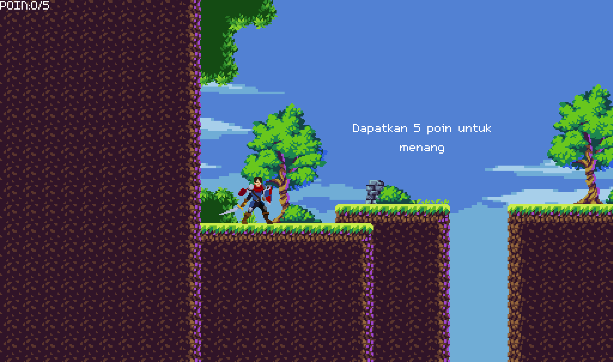
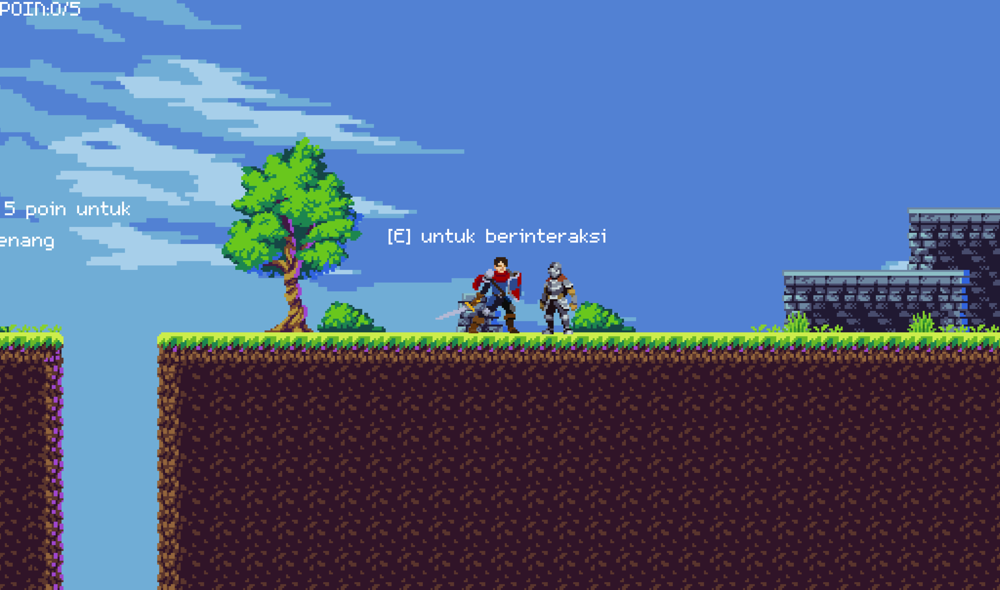
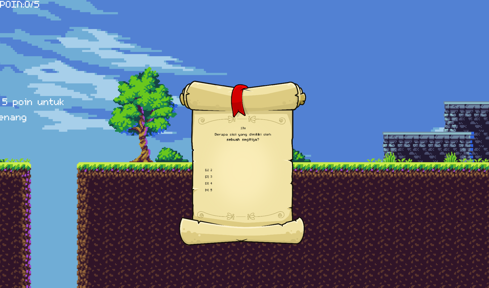
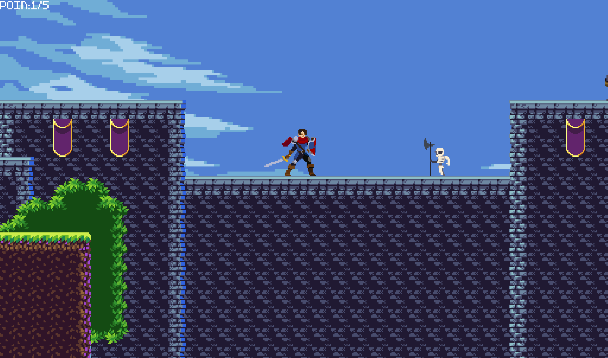
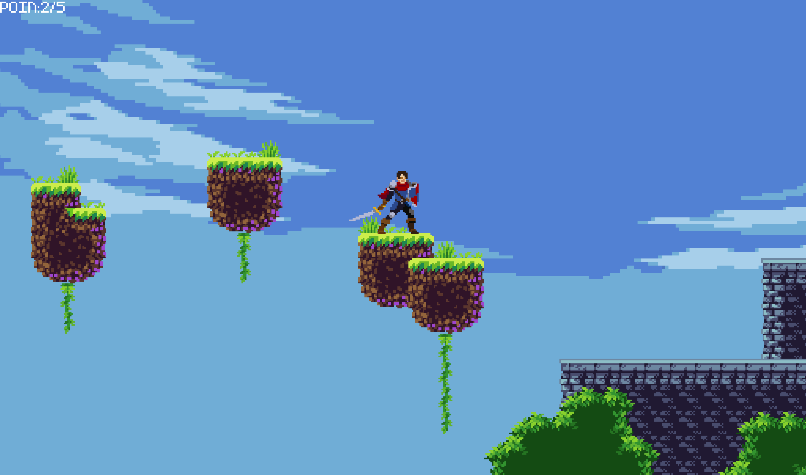
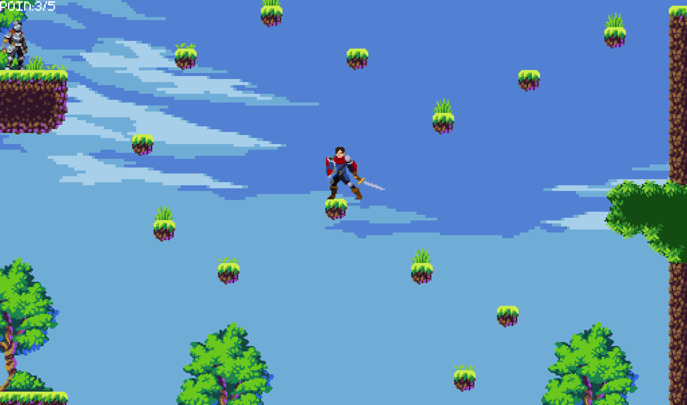
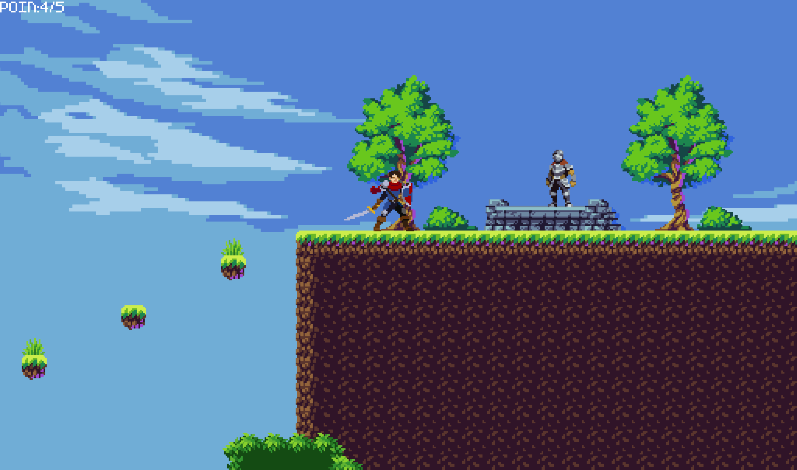
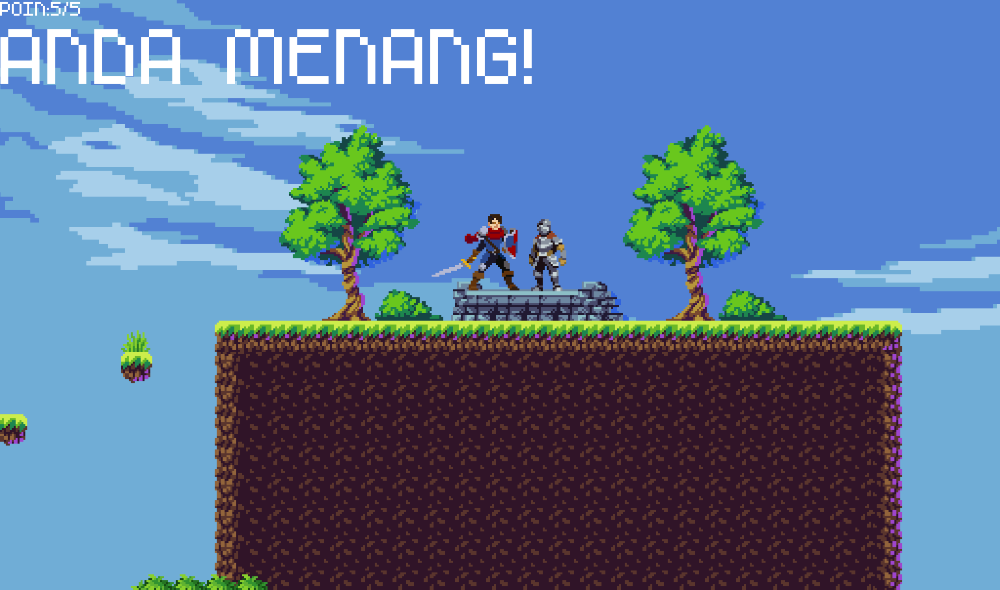

# 🎮 CS Knight

**Explore the level. Answer the questions. Earn your victory.**

A 2D platformer and quiz game built with Godot.

[Repository](https://github.com/javierreansyah/cs-knight)

## 💡 About the game

CS Knight combines platforming with timed general knowledge questions. Guide your character across platforms, avoid skeletons and hazards, and interact with characters to answer questions in Indonesian. Earn five points to win.

## ✨ Features

- **Platforming challenges:** Move and jump across the level while avoiding hazards and skeletons.
- **Timed quizzes:** Answer randomly selected multiple-choice questions within 20 seconds.
- **Five points to win:** Each correct answer earns a point. A wrong answer or running out of time ends the attempt.
- **Pixel-art adventure:** Explore a 2D world with animated characters, music, and sound effects.

## 📸 Explore CS Knight

| Start the adventure | Your first interaction |
| --- | --- |
| [](docs/images/start.png) | [](docs/images/first-interaction.png) |
| **Answer a question** | **Encounter an enemy** |
| [](docs/images/quiz.png) | [](docs/images/enemy-encounter.png) |
| **Cross the platforms** | **Keep moving** |
| [](docs/images/parkour-1.png) | [](docs/images/parkour-2.png) |
| **Aim for five points** | **Victory** |
| [](docs/images/to-win-the-game.png) | [](docs/images/win.png) |

## 🎮 How to play

1. Move through the level and avoid hazards and skeletons.
2. Press **E** near an interaction to open a question.
3. Press **1–4** to choose an answer before the 20-second timer runs out.
4. Answer five questions correctly to win. A wrong answer, timeout, or collision with a hazard ends the attempt and restarts the level.

**Controls**

- **A / Left arrow:** Move left.
- **D / Right arrow:** Move right.
- **W / Up arrow / Space:** Jump.
- **E:** Interact.
- **1–4:** Select a quiz answer.

## 🚀 Get started

### 💻 Run from source

Install **Godot 4.2** with the Forward+ renderer, then clone the repository:

```powershell
git clone https://github.com/javierreansyah/cs-knight.git
cd cs-knight
```

Open `project.godot` in Godot and run the project with **F5** or the Play button.

## 🛠️ Built with

- **Godot 4.2:** Scenes, 2D physics, animation, and audio.
- **GDScript:** Player movement, interactions, quizzes, and scoring.

## 📄 License

CS Knight is available under the [MIT License](LICENSE).

## 🤝 Team

- Achmad Fauzi Aranda
- Gede Indra Adi Brata
- Haikal Thoriq Athaya
- Javier Aahmes Reansyah
- Muhammad Herdi Adam
